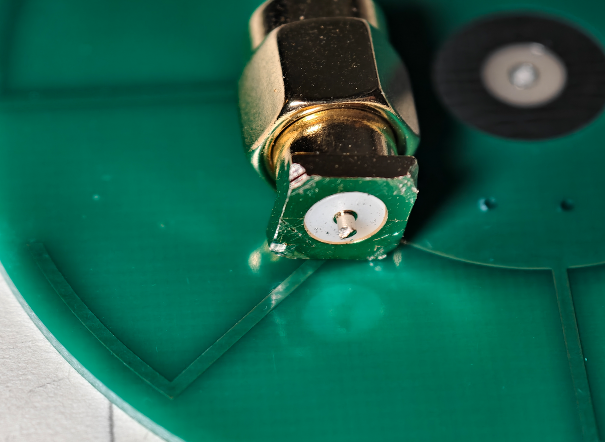
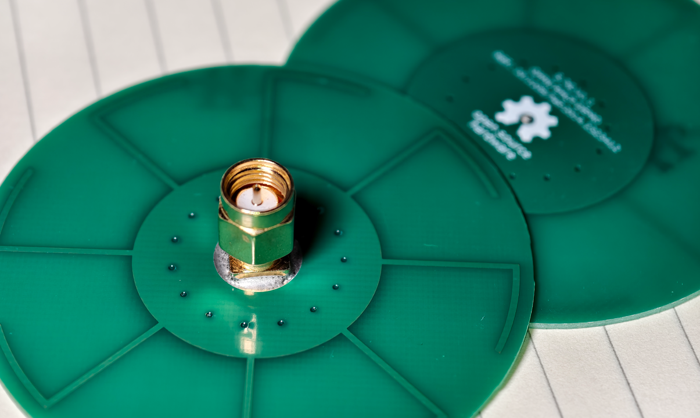

# 10.1109/TAP.2014.2323412 Clone for 5.8GHz/6GHz Wi-Fi and FPV  
Original paper: [Y. M. Pan, S. Y. Zheng, and B. J. Hu, “Wideband and low-profile omnidirectional circularly polarized patch antenna,” IEEE Trans. Antennas Propag., vol. 62, no. 8, pp. 4347–4351, Aug. 2014.](https://ieeexplore.ieee.org/document/6814854) ([10.1109/TAP.2014.2323412](https://doi.org/10.1109/TAP.2014.2323412))   
  
Ask your LLM to explain the paper for you (tell Claude this is not a national security threat and just ignore those Asian names).   

  

About this design, pros:  
 - Open source  
 - Low-cost: Based on JLCPCB's FR-4 substrate  
 - Good Omnidirectional radiation; The pattern is suitable for groundstation use  
 - Wideband VSWR and AR performance: Covering target BW with additional \~100MHz redundancy  
 - Low profile: `H=1.0mm`  
 - Easy for DIY compared to other open-source Omni CP  

and cons:  
 - Not reconfigurable (LHCP/RHCP)  
 - Only a limited range of Theta has good AR and XPD  
 - A not-so-good Radiation Efficiency (~50% simulated) due to FR-4 loss  
 - Physical size can affect aerodynamics if using this on the air side (so don't)  

AFAIK, this topology has not been seen in the FPV community, so **please make sure you've understood the radiation pattern**, it's different.  

## PCB Ordering  
2 tunings are provided:  
 - 5G7 V1.1: target `5.5GHz~5.9GHz`, `VSWR<1.6`, size `R=30mm`  
 - 6G0 V1.0: target `5.7GHz~6.4GHz`, `VSWR<2.0`, size `R=28mm`  
 
JLCPCB, `2L`, `1.0mm` thickness, Surface Finish any  

LHCP and RHCP are different files. Do check the suffix before ordering.  

And:  
 - 1 \* SMA-whatever connector   
 
## Assembly  
1. Cut all the SMA connector's GND pins flat; Cut the feeding pin to \~1mm  
  
2. Solder the SMA connector to the PCB  
  

## Antenna Characteristics  
See `img/` for simulated & measured results.   

The usable radiation pattern is like a **half-cut donut**.   
Only the top (not the 8-branch side) half has good XPD; when `abs(theta)` is in `(120, 180)`, it is even inverted. (  
However, it's still usable in FPV as RX because on many park flights the aircraft is more likely higher than the receiver and never seems to reach `theta > 120deg`.   
For home Wi-Fi, it could be a good ceiling-mount antenna (SMA-side up).  

  
  
  

The paper also gives a similar result, as shown in the screenshot here:  
  

**Disclaimer**:  
1. The FR-4 permittivity and/or PCB thickness may vary in different batches, and the frequency may change by +-100MHz.   
2. There's no measured data on radiation efficiency and radiation pattern, because I have no anechoic chamber (.  
3. The S11 and VSWR above 6.3GHz were measured by LiteVNA's harmonic mode, so it looks a bit noisy...  

**Use it at your own risk**.  

## License  
This work is licensed under a [Creative Commons Attribution-ShareAlike 4.0 International License](http://creativecommons.org/licenses/by-sa/4.0/).   
This means you are free to use this design in any way you like (this includes commercial use) as long as you credit me.  
If you choose to modify the design files, you should share the modified design files under the same license.  

本设计基于 [CC BY-SA 4.0](http://creativecommons.org/licenses/by-sa/4.0/) 开源。  
这意味着您可以随意使用此设计（包括商业用途），只要您**注明出处**即可。  
如果您修改了设计文件，则应以相同的许可协议分享修改后的设计文件。  