# PatchArrayCP
This is a set of very simple CP patch antenna arrays.  

When I was reading that well-praised [Triple Feed Patch Array by Maarten Baert](https://www.maartenbaert.be/quadcopters/antennas/triple-feed-patch-array-antenna/) (thanks, Maarten!), it says "Most FR4-based patches... ", and "Additionally, most array antennas... "... (mostly cons). 
I know they will be lossy, but I don't know how lossy it will be, and there is no open-source design till then... so out of curiosity I have to make one from scratch. 

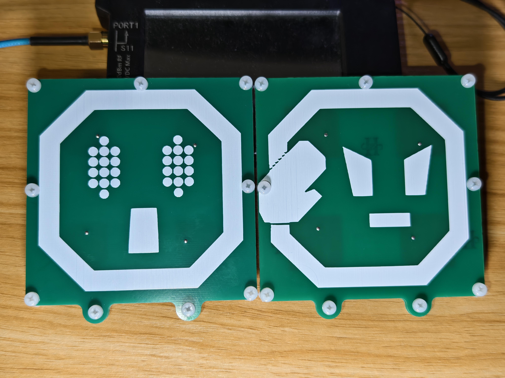  

## Variants 
See `./<design>/img*/` for detailed simulated & measured results.   

`5G2_2x2`: Size `90mm * 90mm * 4.0mm` (SMA not included), LHCP, target `5.18GHz \~ 5.32GHz` (Wi-Fi channel `36 \~ 60`), Realized Gain > 11dBi (peak ~12dBi), 35deg/35deg 3dB beamwidth;  

`6G2_2x2`: Size `90mm * 90mm * 4.0mm` (SMA not included), LHCP, target `5.925GHz \~ 6.425GHz` (Wi-Fi 6e/7/...'s lower 6GHz band), Realized Gain > 12dBi (peak ~13dBi), 30deg/30deg 3dB beamwidth; 
(bonus -- also usable in `5.745GHz \~ 5.825GHz` (Wi-Fi channel `149 \~ 165`) with a Realized Gain > 11dBi)    

For 5.5~5.9GHz band, just use the Triple Feed Patch (Array). It's definitely better.  

The 2 holes at the bottom are `M3` with `36mm` spacing. Compatible with some AAT mounting.  

## PCB Ordering 
For all PCBs in folder: JLCPCB, `2L`, `1.0mm` thickness, Surface Finish: any  
`Gerber*.zip`: exported Gerber files  
`ProDoc*.epro2`: Use 嘉立创EDA专业版 (EasyEDA PRO) to import it, then modify (**ONLY** use it when you need to bypass the free sample's similarity check in JLCPCB; **DO NOT TOUCH the copper & board outline**, just add some small silk on the edge)   

And: 
 - 1 \* Surface-mount SMA connector (same as triple feed patch)   
 - 9 \* M3x8 nylon screw   
 - 9 \* M3 nylon nut  
 - 9 \* 5mm(outer)\*3mm(inner)\*2mm(height) nylon spacer  
 - Some copper wire, diameter = 1.0 mm 
 
The height of the nylon spacer should be ** 2.0 mm **. This is critical.  

## Assembly  

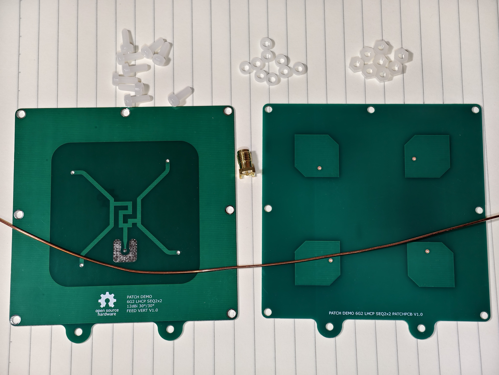  

1. Solder the SMA connector to the feed PCB:  

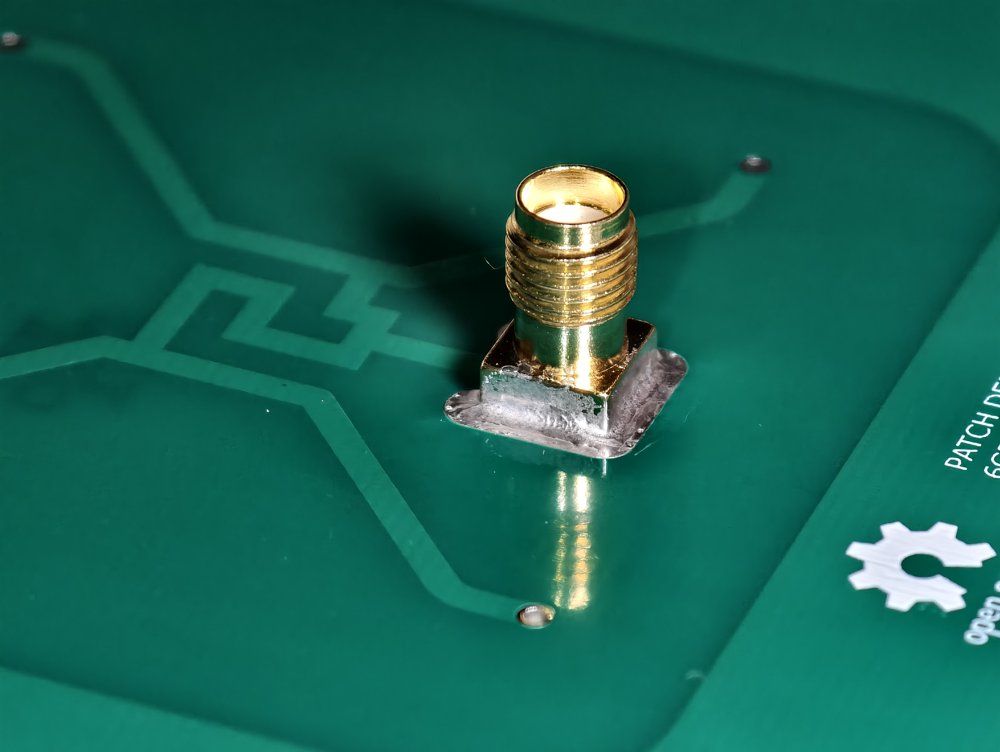  

2. Cut some copper wire and solder to the patch PCB as shown in the image below:  

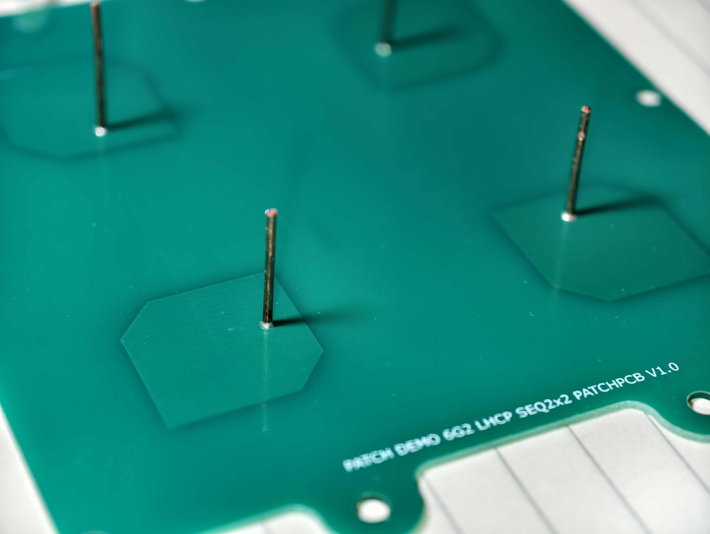  

Trim the pin at the other side, make the plate FLAT, and clean the PCB: 

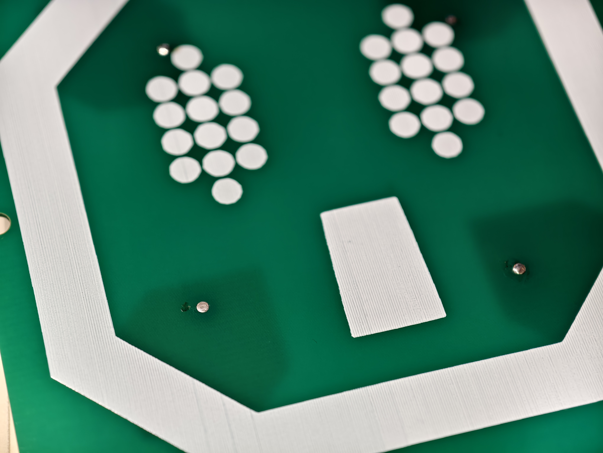  
  
3. Stack the two PCBs, and use nylons to screw:  
(Make sure the two PCBs are parallel with 2mm spacing, this is critical; sometimes the PCB may be warped)  

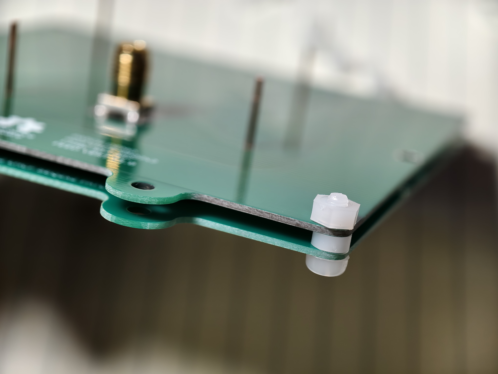  
  
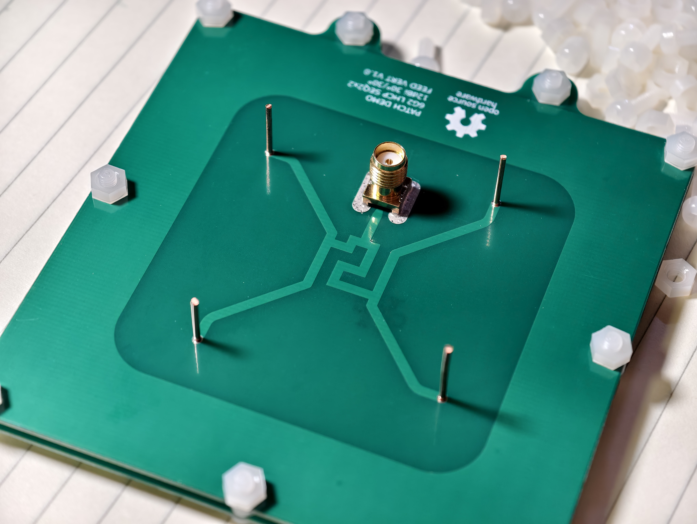  
  
4. Cut the copper wire to flat, then solder:  

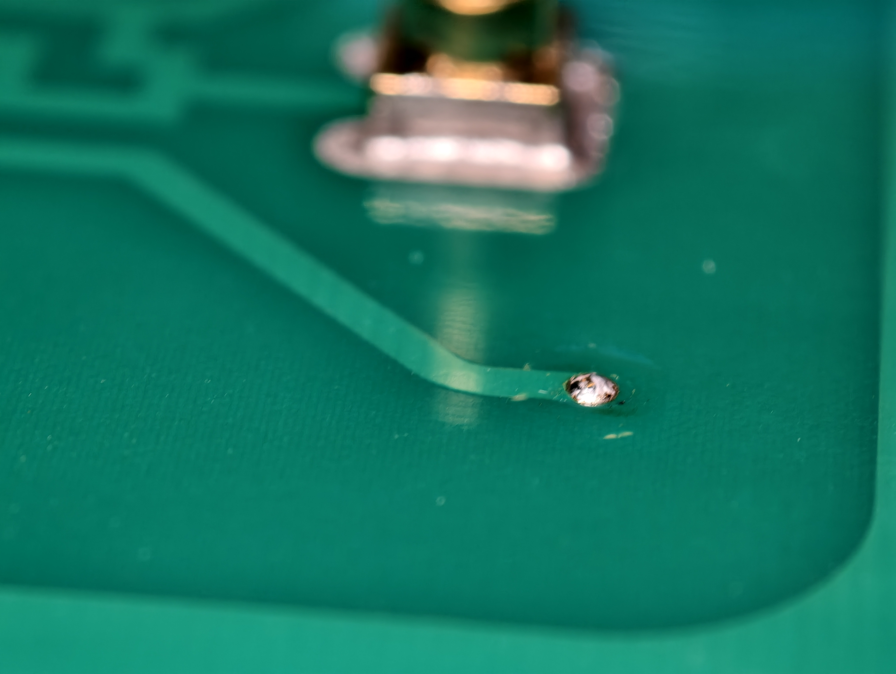  

5. Done. Test it with your VNA )  

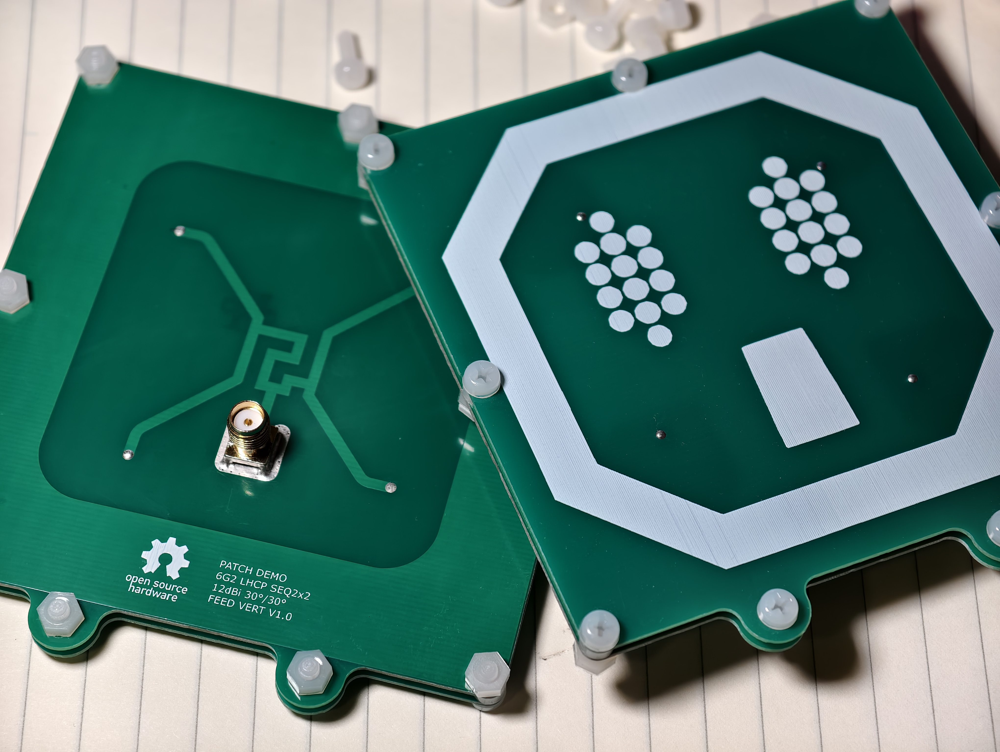  

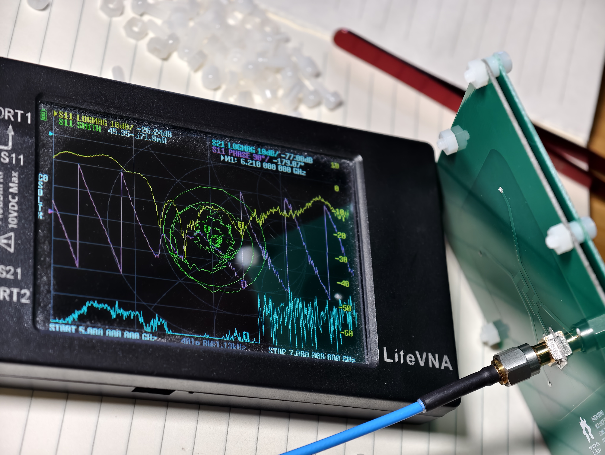  

## Antenna Design & Characteristics 

This design was from scratch. It goes in a 'regular way' (compare with the TFP(A)), combining 2x2 simple patch CP antennas (square patch, chamfered, air substrate) with a sequential rotating feeding network.  

The array is separated by 45mm, which is `0.93*λ0(6.2GHz)` and  `0.78*λ0(5.2GHz)`. So there will be some small sidelobes. 
2x2 is the maximum array we can get cheaply (5 pcs free samples in China / $2 others) from JLCPCB.  

I took the feeding network from the paper: [Lin, S. and Y. Lin, "A compact sequential-phase feed using uniform transmission lines for circularly polarized sequential-rotation arrays," IEEE Trans. Antennas Propag., Vol. 59, No. 7, 2721-2724, 2011.](https://ieeexplore.ieee.org/document/5765453/)   

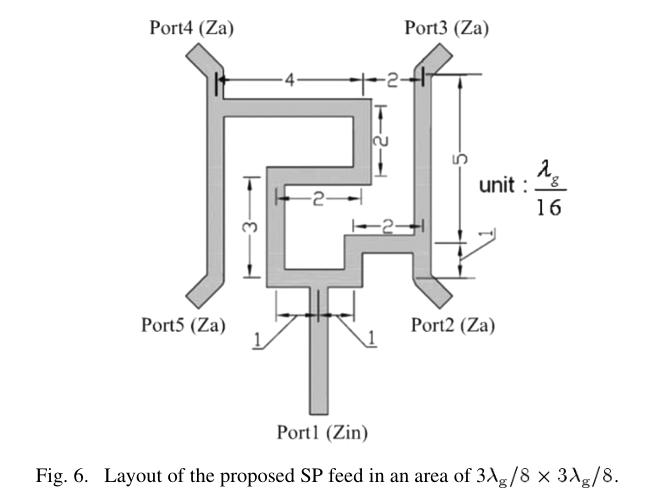  
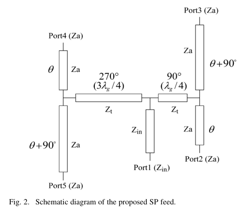  

The single patch already gives two zeros, and the feeding network then extends the -10dB S11 and 3dB AR bandwidth to ~20%.  
The loss is mainly from the feeding network, microstrip on FR-4 substrate.    

The HFSS model contains some estimated (by my experiment) constants. I tried to compensate for many things that are not ideal.  
In image you'll see the HFSS model uses a very simple wave port as the feeding (I'm too lazy to model the connector), and the PCB design copied the connector footprint from Triple Feed Patch. The result seems good.     

There's no measured data on radiation efficiency and radiation pattern, because I have no anechoic chamber (.  
The S11 and VSWR performance above 6.3GHz of the 6G2 variant was measured by LiteVNA's harmonic mode, so it looks a bit noisy...  

To improve bandwidth and antenna efficiency, this design uses air as the patch antenna's substrate, so please make sure that there's nothing between the two PCBs except clean, dry air.  

**Use it at your own risk**.  

## License
This work is licensed under a [Creative Commons Attribution-ShareAlike 4.0 International License](http://creativecommons.org/licenses/by-sa/4.0/).   
This means you are free to use this design in any way you like (this includes commercial use) as long as you credit me.  
If you choose to modify the design files, you should share the modified design files under the same license.  

本设计基于 [CC BY-SA 4.0](http://creativecommons.org/licenses/by-sa/4.0/) 开源。  
这意味着您可以随意使用此设计（包括商业用途），只要您**注明出处**即可。  
如果您修改了设计文件，则应以相同的许可协议分享修改后的设计文件。  
