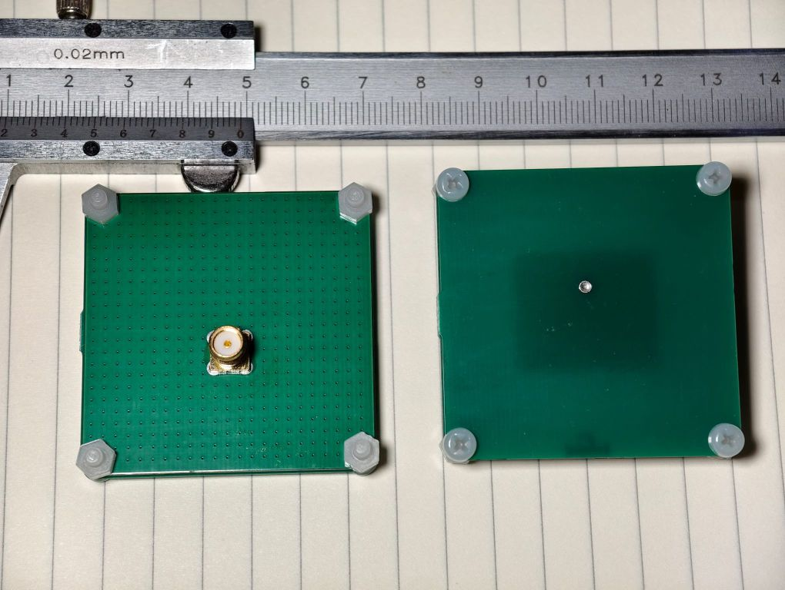
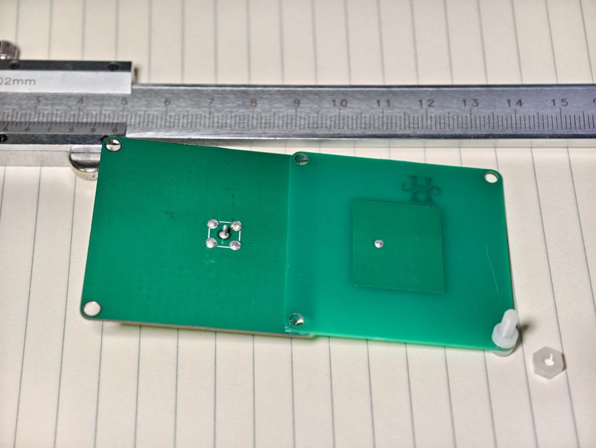

# SimplePatch 5G7
This is a very simple 8dBi linear-polarized patch antenna tuned to 5.5GHz\~5.7GHz.  The best channel should be somewhere around 5.6GHz. 
(A linear patch is like the "hello world" you wrote in programming 101 ... don't be too serious)  

  

## Design Files
ProDoc_patch_demo_5g7_v1p0.epro2: Use EasyEDA to import it if you need to modify it  
Gerber_patch_demo_5g7_v1p0.zip: exported Gerber files  
Size: 48mm \* 48mm \* 4.0mm (SMA not included)  

## PCB Ordering 
JLCPCB, `2L`, `1.0mm` thickness, Surface Finish any  

And: 
 - 1 \* SMA-KE connector   
 - 4 \* M3x8 nylon screw   
 - 4 \* M3 nylon nut  
 - 4 \* 5mm(outer)\*3mm(inner)\*2mm(height) nylon spacer  
 
The height of the nylon spacer should be **2.0mm**. This is critical.  
The design uses the pin on the SMA connector (it should be 4mm long) as feeding, so no additional metal wire is needed.  

Assembly:  
 1. Cut the four GND pins on the SMA connector to <= 1 mm in length (keep the feeding pin 4mm)  
 2. Cut to separate the two PCBs: the GND one (copper-filled) and the patch (no filling, only one rectangular with a hole)  
 3. Solder the 5 pins to the GND PCB. **Keep the 4 GND holes FLAT**  
 4. Stack two PCBs and use the nylons to screw. **Separate the two PCBs by 2.0mm using the spacer; The copper patch should be on the inner side; there's no FR-4 between the patch copper and GND**  
 5. Solder the feeding pin on the patch  

 

## Antenna Characteristics
See `img/` for simulated & measured results.   

1. To improve bandwidth and antenna efficiency, this design uses air as the patch antenna's substrate (instead of lossy FR-4), so please make sure that there's nothing between the two PCBs except clean, dry air.  
2. H2O is polar, so in some super-moist areas the center frequency may drift 10\~30MHz lower. And do check if there's any condensed water on the PCBs' inner surface.  
3. There's no measured data on radiation efficiency and radiation pattern, because I have no anechoic chamber (.  
4. The HFSS model contains some estimated (by my experiment) constants. I tried to compensate for many things that are not ideal.  

**Use it at your own risk**.  

## License
This work is licensed under a [Creative Commons Attribution-ShareAlike 4.0 International License](http://creativecommons.org/licenses/by-sa/4.0/).   
This means you are free to use this design in any way you like (this includes commercial use) as long as you credit me.  
If you choose to modify the design files, you should share the modified design files under the same license.  

(Why I'm licensing a helloworld.c so seriously...)  

本设计基于 [CC BY-SA 4.0](http://creativecommons.org/licenses/by-sa/4.0/) 开源。  
这意味着您可以随意使用此设计（包括商业用途），只要您**注明出处**即可。  
如果您修改了设计文件，则应以相同的许可协议分享修改后的设计文件。  

这连helloworld都算不上，抄点别的吧，谢谢