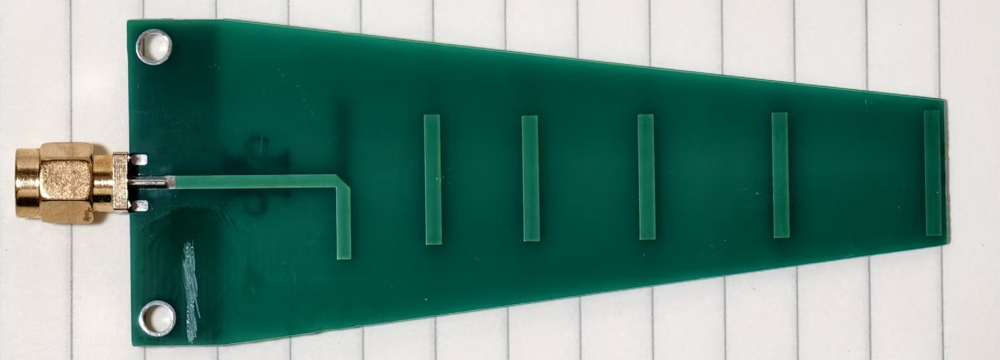

# SimpleYagiUda 5G2/5G7

This is a very simple Yagi-Uda tuned for the 5.2GHz and 5.7GHz band FPV/Wi-Fi.  
Linear polarized, \~9dBi, \~55deg 3dB E/H beamwidth, \~80% radeff   

Had seen the well-known TI [DN034](https://www.ti.com/lit/an/swra350/swra350.pdf) and then did some simplification (emm... fillet and microstrip. I'm lazy) and tuning on JLCPCB's cheapest process. Thanks to TI )  
 
This is a very basic design; it doesn't have any fancy Yagi optimizations, just a dipole, GND reflector, balun (I hope it works so... and you may want to optimize that), plus a few copper squares as directors. No additional zeros were added so it's not a wideband design.  

   
   

## PCB Ordering 
`Gerber*.zip`: exported Gerber files  
`ProDoc*.epro2`: Use 嘉立创EDA专业版 (EasyEDA PRO) to import it, then modify (**ONLY** use it when you need to bypass the free sample's similarity check in JLCPCB; **DO NOT TOUCH the copper & board outline**, just add some small silk on the edge)   

JLCPCB, `FR-4`, `2` Layers, `1.0mm` total.  
This design does not care about the `Surface Finish`. Both `HASL (lead or lead-free)`, `ENIG`, and `OSP` are OK.  

`5G2` PCB Size: `26mm * 90mm * 1.0mm` (SMA not included)  
`5G7` PCB Size: `36mm * 90mm * 1.0mm` (SMA not included)  

## Antenna Characteristics 
See `img/` for simulated patterns and measured S11/VSWR results.   
**I recommend getting at least a LiteVNA or similar to measure, then choose a good channel.**   

**Disclaimer**: 
1. The FR-4 permittivity and/or PCB thickness may vary in different batches, and the center frequency may change by +-100MHz.     
2. There's no measured data on radiation efficiency and radiation pattern, because I have no anechoic chamber (.   

### License
This work is licensed under a [Creative Commons Attribution-ShareAlike 4.0 International License](http://creativecommons.org/licenses/by-sa/4.0/).   
You are free to use this design (including commercial use) as long as you link to here.   
You should share the modified design files under the same license if you modified it.   

本设计基于 [CC BY-SA 4.0](http://creativecommons.org/licenses/by-sa/4.0/) 开源。  
这意味着您可以随意使用此设计（包括商业用途），只要您**注明出处**即可。  
如果您修改了设计文件，则应以相同的许可协议分享修改后的设计文件。  