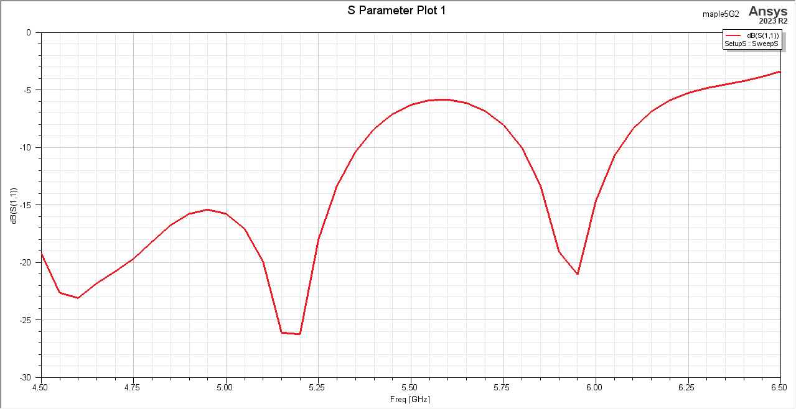
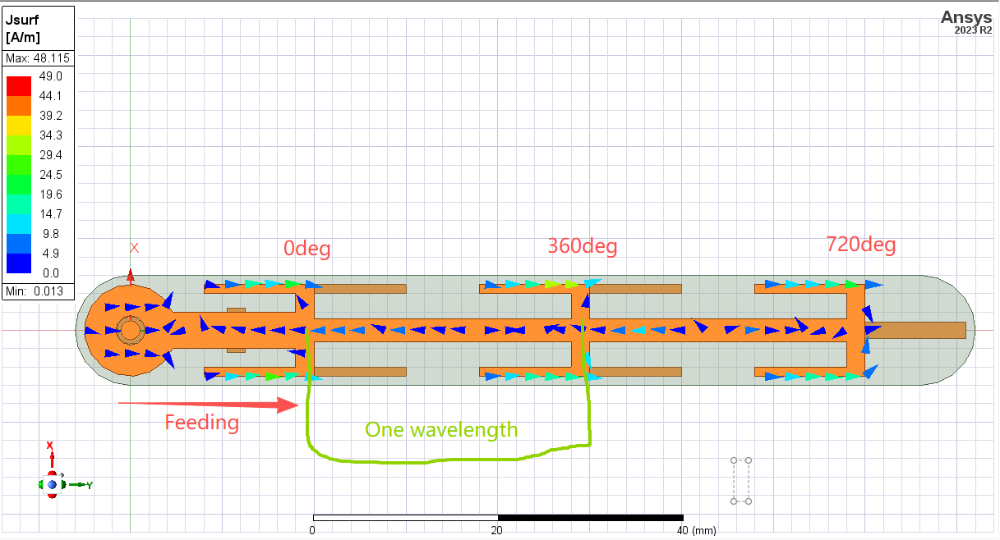
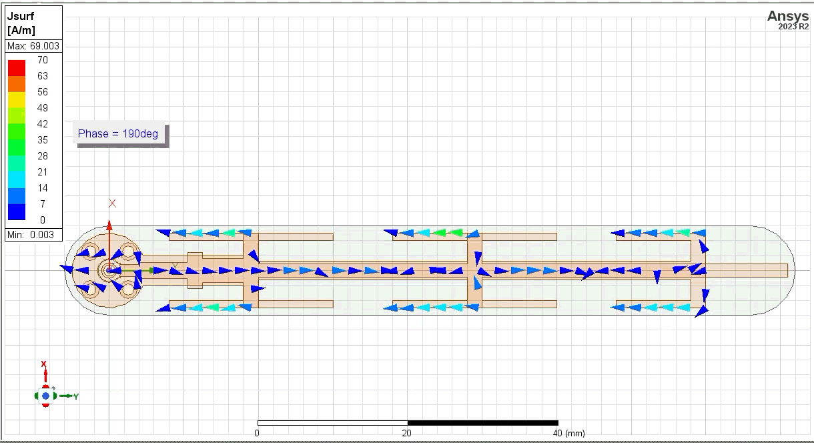
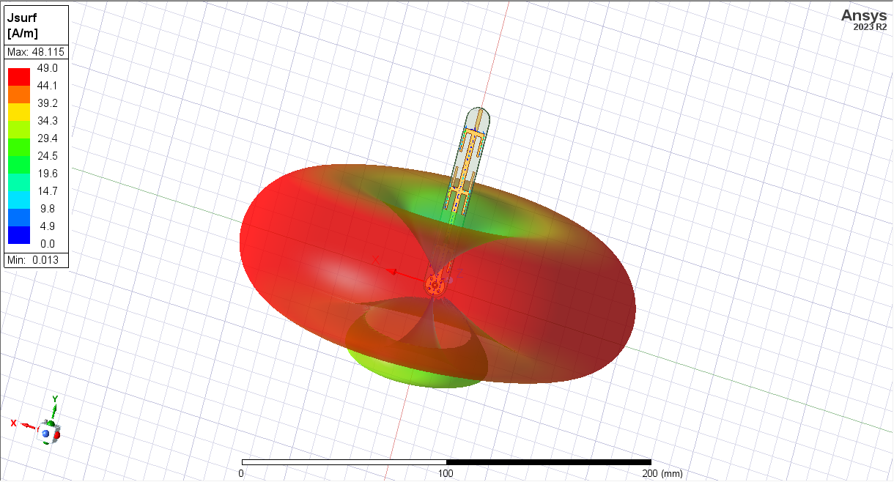
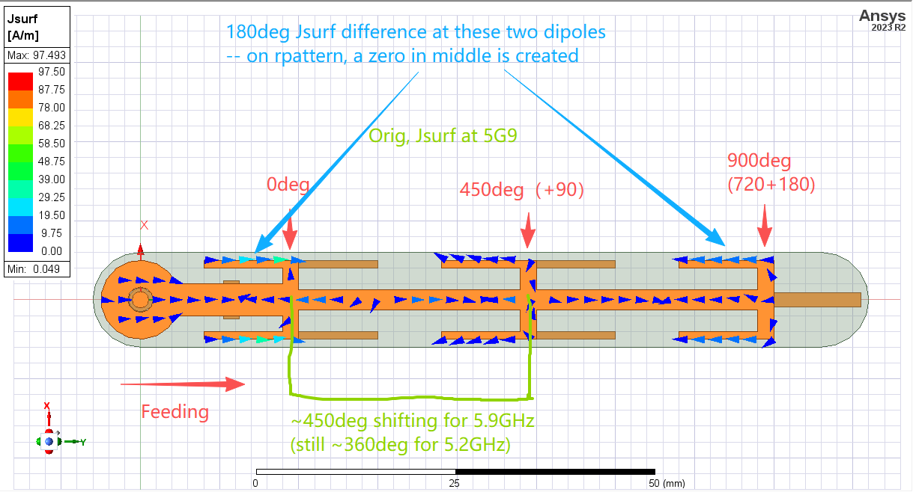
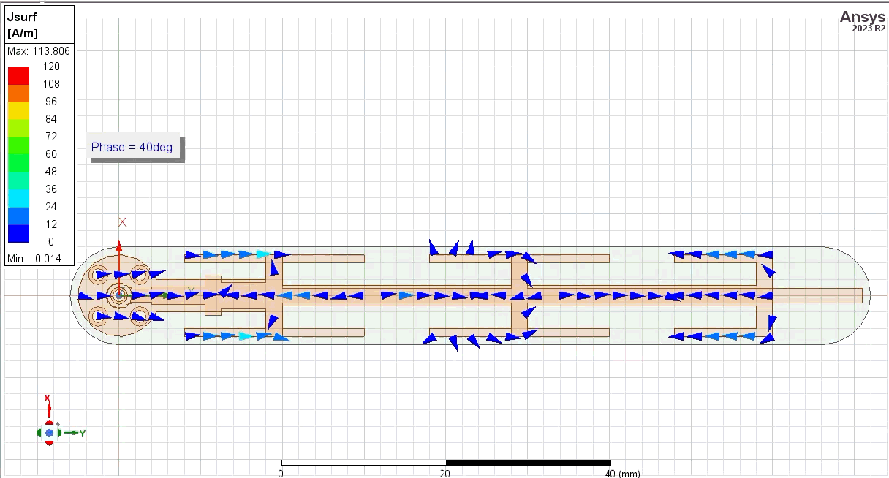
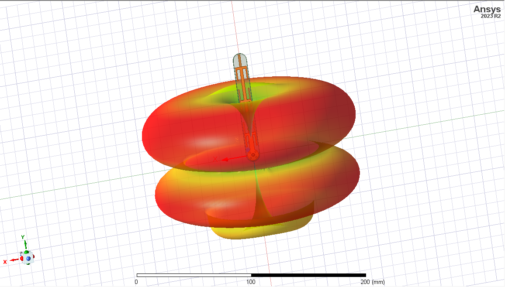
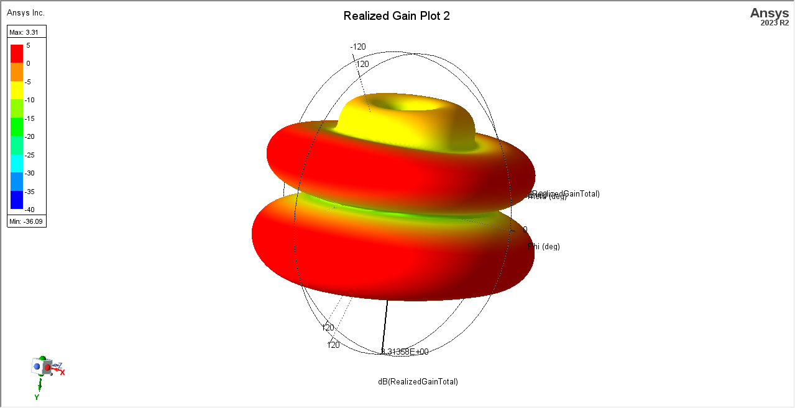

# Notes about original design (5G2)    

I've also reproduced the original 5G2 design in HFSS. (ONLY FOR REFERENCE -- it does not represent the author's).   

The simulated S11 is shown below, and it matches the real measurement:   
   

I've heard some say the 5G2 design is capable of 5.9GHz using, as in S11 there's a zero here. **Of course you can, and your PA will be safe, but the radiation performance will be downgraded.** And here's the explanation:   

This design contains 3 pairs of dipoles with series feeding. To make those dipoles achieve a coherent superposition (and thus higher gain), their feeding phase of them should be the same, or shifted by n*360deg (int n). 

The feeding stripline's length is designed to shift the feeding phase by 360deg each. One wavelength on FR-4 is shorter than in vacuum; here \~30mm for 5.2GHz.  

   

When the original design is working at 5.2GHz, the surface current (vector_jsurf) is as follows (notice the direction of arrows on those dipole arms): 

  

The current on the dipoles is in the same phase. And then they enhance each other in air; that's how it creates a good donut pattern. 
     
    

And when it's working at a higher frequency, the wavelength is shorter than 30mm, and the shifting error accumulates. So, coincidentally, the first and the third dipole have a just inverted feeding phase at 5.9GHz:    

   

And the surface current animated (vector_jsurf):  

  

Then, two inverted dipoles will cancel each other, giving a zero in the middle line, thus creating a radiation pattern like this:   

    
    

~~Do we have a bread or something to name this?~~
